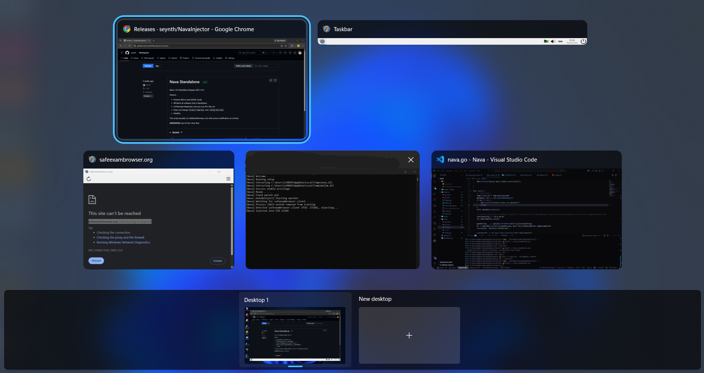

# Nava

Nava bypasses Safe Exam Browser (SEB 3.10.3) desktop isolation by applying patches at runtime using [Harmony 2](https://harmony.pardeike.net/v2/). Because the original files on disk are never modified, the verification hashes generated by SEB remain completely **unchanged**.

<p align="center">
  
</p>

## Features

- **Disables KIOSK Mode & Desktop Isolation**: Prevents SEB from creating a restricted, isolated desktop.
- **Keeps Windows Explorer & Taskbar Active**: Blocks SEB from terminating `explorer.exe` or hiding other running application windows.
- **Unintercepts Keyboard Shortcuts**: Restores full keyboard control, enabling `Alt+Tab`, `Win+Tab`, and Windows hotkeys.
- **Whitelists All Applications**: Bypasses SEB application blacklists and prevents SEB from closing prohibited software.
- **Unblock Clipboard**: Forces clipboard policy to allow copying and pasting across applications without periodic wiping.
- **Allows Screen Capture**: Neutralizes window capture restrictions, enabling screenshots and screen sharing.
- **Bypass Remote Session Detection**: Spoofs remote session checks, allowing operation over remote connections.
- **Suppresses Integrity Alerts**: Silences runtime component violation logs and prevents session lock screens or forced shutdowns.

## Quick Start

1. Download [`nava.exe`](https://github.com/syuhno/Nava/releases).
2. Run `nava.exe` with adminstrator privileges.
3. Once `[Nava] Ready . . .` appears, launch Safe Exam Browser by double clicking *.seb file or from exam provider. **Do not close the terminal.**

> [!WARNING]
> Always exit SEB using the built-in power button on the SEB taskbar.

---

## Build from Source

### Prerequisites
- [Go Latest Version](https://go.dev/dl/)
- [.NET SDK](https://dotnet.microsoft.com/en-us/download)
- [Make](https://community.chocolatey.org/packages/make)

#### Installing Make with Chocolatey
If you do not have `make` installed on Windows:

1. Open **PowerShell as Administrator** and install [Chocolatey](https://chocolatey.org/install):
   ```powershell
   Set-ExecutionPolicy Bypass -Scope Process -Force; [System.Net.ServicePointManager]::SecurityProtocol = [System.Net.ServicePointManager]::SecurityProtocol -bor 3072; iex ((New-Object System.Net.WebClient).DownloadString('https://community.chocolatey.org/install.ps1'))
   ```
2. Install `make`:
   ```powershell
   choco install make
   ```
3. Restart your terminal.

---

### Build
Run `make` from the repository root (NuGet packages will be downloaded and restored automatically):

```bash
# Build all executables (both terminal & no-terminal versions)
make all

# Or build individually
make terminal
make no-terminal

# Clean build artifacts
make clean
```

The resulting executables will be located at:
- `injector/nava.exe` (Terminal)
- `injector/nava_no_terminal.exe` (No Terminal)

> [!NOTE]
> Sometimes when you build the executable, Windows Defender will block it. You need to either whitelist the executable or disable realtime protection windows defender temporarily.
